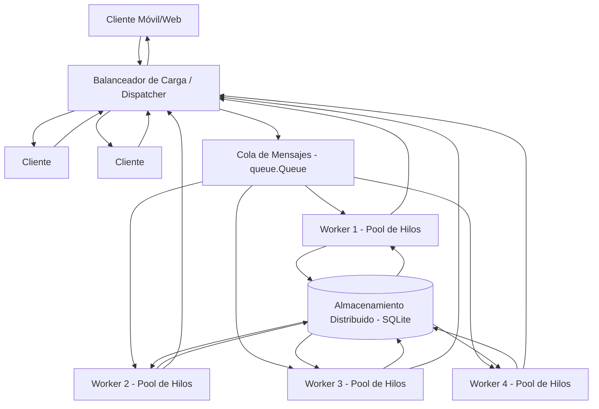

# Diagrama de Arquitectura - PFO 3

## Arquitectura Distribuida Cliente-Servidor

## Componentes

| Componente | Descripción | Implementación |
|------------|-------------|----------------|
| **Clientes (móviles, web)** | Múltiples clientes que envían tareas al sistema | `client.py` - Simula clientes conectándose por sockets TCP |
| **Balanceador de Carga / Dispatcher** | Punto de entrada único. Recibe peticiones, las distribuye y gestiona respuestas | `dispatcher.py` - Servidor socket que acepta conexiones y enruta |
| **Cola de Mensajes** | Desacopla la recepción del procesamiento. Garantiza distribución ordenada | `queue.Queue()` - Simula RabbitMQ para comunicación entre componentes |
| **Servidores Workers (con pool de hilos)** | Procesan las tareas de forma concurrente | `worker.py` + `ThreadPoolExecutor` - Múltiples hilos procesando en paralelo |
| **Almacenamiento Distribuido** | Persistencia de datos compartida entre workers | `SQLite (mensajes_pfo3.db)` - Simula almacenamiento distribuido (PostgreSQL/S3) |

## Flujo de comunicación

1. **Cliente** se conecta al **Dispatcher** (balanceador) vía socket TCP
2. **Dispatcher** recibe la tarea y la coloca en la **Cola de Mensajes**
3. **Workers** (del pool de hilos) toman tareas de la cola y las procesan
4. **Worker** guarda el resultado en el **Almacenamiento** y lo devuelve
5. **Dispatcher** recibe el resultado y lo envía al **Cliente** que lo solicitó

## Rediseño desde PFO 1

| Aspecto | PFO 1 (Monolítico) | PFO 3 (Distribuido) |
|---------|-------------------|---------------------|
| **Arquitectura** | Servidor único atiende clientes directamente | Dispatcher + Workers distribuidos |
| **Concurrencia** | Atención secuencial o simple por conexión | Pool de hilos con workers concurrentes |
| **Escalabilidad** | Limitado a un proceso | Se pueden agregar más workers |
| **Desacoplamiento** | Acoplado (recepción + procesamiento juntos) | Desacoplado con cola de mensajes |
| **Responsabilidades** | Una entidad hace todo | Separación: recepción / distribución / procesamiento / almacenamiento |
| **Tolerancia** | Punto único de fallo | Componentes separados, más robusto |
